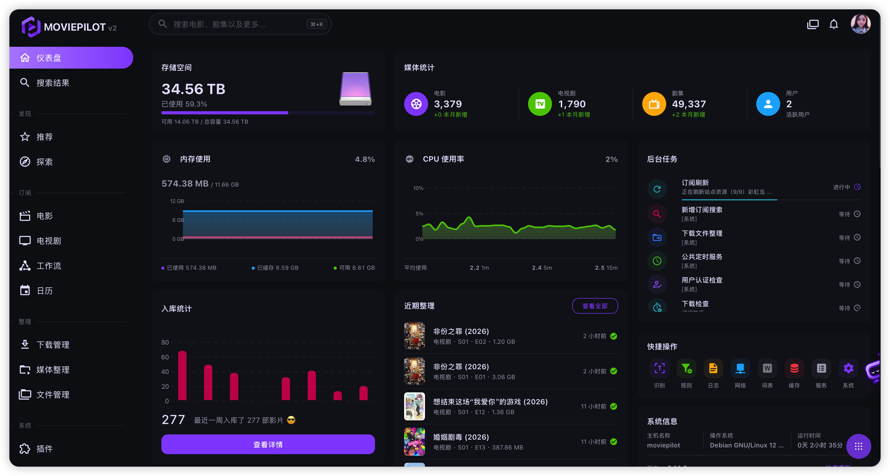

# 文档按使用任务组织

首页按 **开始使用 → 安装 → 用户指南 → 连接与扩展 → 维护与排障 → 开发者** 提供入口。每个专题回答一个实际问题，并链接到前置条件、后续步骤和排障页。

优先补充现有页面，只有主题有明确边界时才新建页面。保留已有根路径和重要标题锚点；调整首页导航即可改善阅读顺序，不必为分类移动全部文件。

| 内容 | 维护位置 |
| --- | --- |
| 首次安装与完整验收 | `/quickstart`、`/ready`、`/install` |
| 用户功能步骤与失败检查 | 搜索、下载、订阅、整理、音乐等专题 |
| 配置方法 | `/configuration` |
| 配置字段、类型、默认值 | 自动生成的 `/configuration-reference` |
| 运维与数据安全 | 升级、备份、数据库、反向代理、诊断 |
| 完整开发合同、API 与代码规范 | 对应源码仓库，Wiki 保留入门及链接 |
| 社区勋章与荣誉榜 | 自动生成流程，不直接改生成结果 |

# Wiki.js 页面格式

根目录页面由 Wiki.js Git 存储同步使用，本仓库不是 VitePress、Docsify 或其他静态站点项目。不要添加会改变发布路径的另一套构建框架。

## 元数据

每个发布页以 YAML 元数据开始，`README.md` 与脚本说明不是发布页。示例：

```yaml
---
title: 页面标题
description: 用一句话说明本页解决的问题
published: 1
date: 2026-11-19T00:00:00.000Z
tags: 分类, 关键词
editor: markdown
dateCreated: 2026-11-19T00:00:00.000Z
---
```

修改内容时更新 `date`，保留原 `dateCreated`。文件名使用稳定、简短的英文小写路径，页面标题使用中文。代码生成页的日期和来源由生成器维护。

## 站内链接与图片

```markdown
[安装指引](/install)
[目录与路径](/directories)

```

Wiki 正文使用根路径，不写本机路径，也不把 `.md` 后缀加到正式 Wiki 路由。GitHub 的仓库 README 则用 `install.md` 这类相对文件链接。

引用具体小节前检查渲染后的锚点，尤其是中文、数字开头、标点和重复标题；不要凭显示标题猜测所有渲染器都生成同一种 ID。

## 提示块、链接列表与页签

提示类标记独占一行，紧跟对应引用块：

```markdown
> 操作前先核对目录并备份。
{.is-warning}
```

导航列表使用 Wiki.js 的链接列表格式：

```markdown
- [快速上手 *先完成一个小样本。*](/quickstart)
- [故障排除 *按失败环节检查。*](/troubleshooting)
{.links-list}
```

页签组的标题与子标题层级需要匹配，例如：

```markdown
## 部署方式 {.tabset}

### Docker

容器部署说明。

### 本地 CLI

本地部署说明。
```

不要把 `{.links-list}` 放进普通段落，也不要在页签层级间随意插入同级标题。已有 HTML 图标与旧页签形式应在实际 Wiki.js 中确认兼容后再改。

## 示例与截图

- 代码块注明 `shell`、`yaml`、`json`、`nginx` 等语言并闭合围栏。
- YAML 使用空格，不能用 Tab 缩进；Compose 的环境替换、服务名与容器名分别说明。
- 用明确占位符，不放真实 Cookie、Token、Passkey、私有地址或个人媒体数据。
- 命令应标明适用部署与版本，不让 V2 命令出现在 V3 默认路径中。
- 截图只用于辅助，核心步骤仍应有文字；界面变化后检查截图是否误导。

格式参考：[Wiki.js Markdown 文档](https://docs.requarks.io/en/editors/markdown)。

# 从哪里核实事实

| 文档主题 | 优先核验来源 |
| --- | --- |
| 安装、CLI、Python 与依赖 | 主仓 `docs/cli.md`、安装脚本、`pyproject.toml`、`uv.lock` |
| 配置默认值 | 主仓配置模型、日志模型与 `system_settings_catalog.json` |
| 界面入口、字段和选项 | 前端页面、表单、中文翻译与 API 类型 |
| 订阅、整理、存储、工作流 | 主仓应用合同、Schema、流程实现与相关测试 |
| 插件开发 | 插件仓开发指南、SDK 与前端模块联邦文档 |
| 站点资源 | Build 源码与版本、Resources 发布目录、实例实际加载版本 |
| App 与推送 | App 指南、前端桥接与 Server 推送文档 |
| OCR | OCR README、HTTP 实现与主程序调用适配器 |

核对基线记录在[源码快照清单](https://github.com/jxxghp/MoviePilot-Wiki/blob/main/scripts/docs/sources.json)，它表示文档审阅时使用的提交，不承诺这些分支以后不变。

不要从旧 Wiki 复制一条看似合理的版本要求，再把它当成源码证据。源码文档之间冲突时，应检查实现、测试和当前发布边界，必要时在文档中说明限制。

# 本地检查

优先使用 Wiki 项目自己的虚拟环境：

```shell
python3.12 -m venv .venv
.venv/bin/python -m pip install -r scripts/docs/requirements.txt 'pytest>=8,<10'
.venv/bin/python scripts/docs/check.py
.venv/bin/python -m pytest scripts/docs/tests -q
git diff --check
```

已有虚拟环境时直接复用。检查包括元数据、代码围栏、YAML/JSON 语法、Markdown/HTML 站内链接、图片、标题锚点与从首页到各发布页的可达性。它不访问真实实例，也不执行文档中的下载、还原或删除命令。

同级源码仓库已抓取清单中的提交时，还可离线验证官方源码文件链接：

```shell
.venv/bin/python scripts/docs/check.py --source-root ..
```

更新配置索引时，从已同步且配置源文件没有未提交修改的后端生成，再审阅差异：

```shell
.venv/bin/python scripts/docs/generate_configuration.py --backend-dir ../MoviePilot
.venv/bin/python scripts/docs/generate_configuration.py --backend-dir ../MoviePilot --check
```

生成器只解析受限 AST 字面量，不导入后端或读取运行配置；新增字段、目录或分组不完整会失败。CI 在本仓库独立执行文档检查与工具测试，跨仓事实复核仍由维护者按源码基线完成。

本地构建缓存、预览与测试产物应放在工作区约定的外置临时目录，不进入文档仓库；使用 pytest 时可用 `--basetemp` 显式指定。

# 渲染与发布验收

1. 检查新旧页面的标题、提示块、表格、长代码、图片、页签和链接列表。
2. 在桌面和窄屏下检查阅读与滚动；不能只看到 Markdown 能解析就认定 Wiki.js 排版正确。
3. 提交前确认没有改到 `community.md`、`community/medals.json` 等自动生成内容，也未误删插件公开仓库清单。
4. 推送后核对最终提交的文档 CI。Git 同步进入 Wiki.js 后，再核对公开页面和新链接。

Wiki.js Git 同步、站点全局侧边栏、编辑器渲染模块与权限属于站点配置，不随普通 Markdown 文件自动建立。仓库维护首页入口；站点若另有固定侧边栏，需在后台同步维护对应导航。

文档问题可向 [MoviePilot-Wiki](https://github.com/jxxghp/MoviePilot-Wiki/issues)反馈，附上页面、预期内容和可核实来源。
