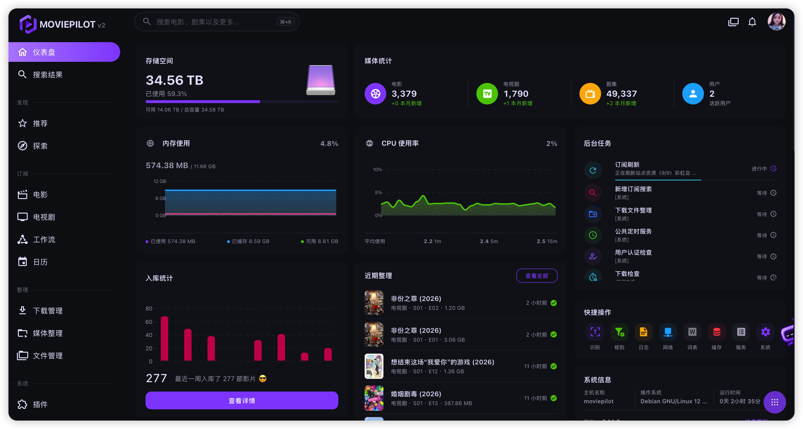

> MoviePilot 基于 NAStool 部分代码重新设计，聚焦自动化核心需求，减少问题同时更易于扩展和维护。

**项目介绍：** https://movie-pilot.org · **API 文档：** https://api.movie-pilot.org · **发布频道：** https://t.me/moviepilot_channel

> 此 Wiki 与 https://github.com/jxxghp/MoviePilot-Wiki 保持同步。
{.is-success}

> 请勿在**任何国内平台**发布或引用此 wiki 任何相关内容，请尽量避免在国内公共场合提及 `MoviePilot` 全称，如确实有需要请使用简称：`MP`。
{.is-danger}

# 开始使用

本文档以 **V3** 为当前使用主线。V1、V2 专属内容会单独标明；已有用户跨主版本切换前，请先阅读升级说明并备份。

| 你现在想做什么 | 从这里开始 |
| --- | --- |
| 第一次部署，让一部媒体完成下载和入库 | [快速上手](/quickstart) |
| 先了解 MoviePilot、播放器和下载器分别负责什么 | [项目与功能地图](/projects) |
| 已经安装，只想找到某项设置 | [配置参考](/configuration) |
| 从 V2 切换，或了解 V3 的媒体与插件边界 | [V3 说明](/v3)、[升级](/upgrade) |
| 自动下载、整理或通知没有按预期工作 | [故障排除](/troubleshooting) |

# 安装

- [环境准备 *网络、配套服务和文件系统条件。*](/ready)
- [安装指引 *Docker、Windows、群晖套件与本地部署。*](/install)
- [本地 CLI *macOS/Linux 安装、初始化和命令行管理。*](/cli)
- [配置参考 *配置来源、界面入口和常用设置。*](/configuration)
- [配置项索引 *从源码生成的类型、默认值与用途。*](/configuration-reference)
- [目录与路径 *容器映射、目录匹配和硬链接条件。*](/directories)
{.links-list}

# 用户指南

建议先走通 **识别 → 搜索 → 下载 → 整理 → 媒体服务器扫描**，再开启订阅和更多自动化。

- [基础 *初始化、用户认证、识别与优先级。*](/basic)
- [站点 *站点凭据、索引、CookieCloud 与连通性。*](/site)
- [搜索 *媒体、站点资源、流式搜索与 AI 推荐。*](/search)
- [下载器连接 *下载器类型、保存路径和路径映射。*](/downloaders)
- [下载 *手动下载、自动整理与远程交互。*](/download)
- [订阅 *追更、补缺、刷新、搜索与洗版。*](/subscribe)
- [文件整理 *整理方式、覆盖策略、预览与重新整理。*](/reorganize)
- [媒体服务器 *连接、库存同步、刷新与播放入口。*](/mediaserver)
- [音乐 *歌曲与专辑的搜索、订阅、整理和刮削。*](/music)
- [自动分类 *分类、规则、预览、影响分析与发布。*](/classification)
- [存储与文件管理 *本地、SMB、网盘与聚合存储。*](/storage)
- [工作流 *组合动作、手动测试、定时和事件触发。*](/workflow)
- [进阶 *优先级规则、识别词和重命名模板。*](/advanced)
{.links-list}

# 连接与扩展

- [通知 *通知渠道、消息类型和远程交互。*](/notification)
- [用户与安全 *账号、渠道授权、API Key 与通行密钥。*](/security)
- [插件 *插件市场、安装、升级和插件数据。*](/plugin)
- [智能助手 *模型设置、工具、技能和使用场景。*](/agent)
- [MCP *第三方 Agent 的 HTTP 接入和参数发现。*](/mcp)
- [iOS 与 PWA *安装、连接、多实例、通知和小组件。*](/mobile)
- [外部集成 *Seerr、Webhook、OCR 和私有消息中心。*](/integrations)
- [周边项目 *社区客户端与浏览器扩展。*](/ecosystem)
{.links-list}

# 维护与排障

- [升级 *镜像、本地 CLI、站点资源和跨版本回退。*](/upgrade)
- [备份与恢复 *在线一致备份、离线还原和迁移验收。*](/backup)
- [数据库与缓存 *SQLite、PostgreSQL、Redis 的选择与部署。*](/database)
- [域名与反向代理 *HTTPS、流式响应和公开访问入口。*](/reverse-proxy)
- [运行维护 *健康检查、日志、定时任务和容量管理。*](/operations)
- [Doctor 诊断 *页面不可用时的离线诊断与安全模式。*](/doctor)
- [故障排除 *按症状逐层定位，并准备有效反馈。*](/troubleshooting)
- [发行说明 *历史重大版本变更。*](/release)
{.links-list}

# 开发者

- [项目与功能地图 *各仓库职责及跨仓修改落点。*](/projects)
- [开发入门 *后端、前端、插件、资源与客户端文档入口。*](/development)
- [:closed_book: 插件开发 *稳定 SDK、模块联邦和发布规范。*](/plugindev)
- [:art: 主题风格 *附加 CSS 的使用与兼容范围。*](/themedev)
- [文档共建 *Wiki.js 格式、来源核验和本地检查。*](/documentation)
{.links-list}

# 参与

- [:question: 提问交流 *访问 Telegram 交流群，请尊重他人、文明礼貌交流。*](https://t.me/moviepilot_official)
- [:fire: Bug 反馈 *提交前先定位失败环节并准备脱敏日志。*](https://github.com/jxxghp/MoviePilot/issues/new?assignees=&labels=bug&projects=&template=bug_report.yml&title=%5B错误报告%5D%3A+)
- [:bulb: 功能建议 *欢迎提出有具体使用场景的改进建议。*](https://github.com/jxxghp/MoviePilot/issues/new?assignees=&labels=feature+request&projects=&template=feature_request.yml&title=%5BFeature+Request%5D%3A+)
- [社区荣誉 *共建者、勋章与统计规则。*](/community)
{.links-list}

# 项目仓库

主程序、前端、插件、App、资源与外围服务的职责和仓库入口统一见[项目与功能地图](/projects)。

# 功能预览

> **https://movie-pilot.org**

