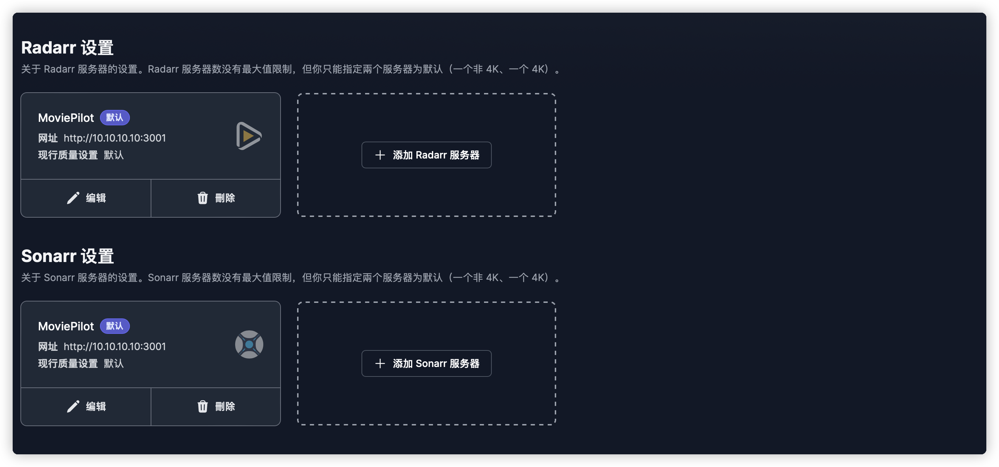

# 网络

MoviePilot 会按功能访问元数据服务、GitHub 发布资源、站点、下载器、媒体服务器、通知平台与模型服务。**浏览器能访问不代表容器或后端进程能访问**，应从实际运行环境验证。

| 目标 | 常见用途 | 失败后的影响 |
| --- | --- | --- |
| TMDB 等元数据源 | 搜索、识别、刮削 | 可能无法正确识别或获取媒体信息 |
| GitHub 与发布资产 | 主程序、前端、插件、站点资源安装和更新 | 安装或下载失败，不宜反复中断后重启 |
| 站点 | 搜索、RSS、下载链接、用户信息 | 对应站点失败，不代表全部站点不可用 |
| 下载器与媒体服务器 | 提交任务、读取库存、刷新和播放链接 | 对应业务阶段失败 |
| 通知、LLM、封面与歌词源 | 可选扩展功能 | 需分别检查网络与凭据 |

### 单独代理

在实际部署配置或 Web 设置中维护 `PROXY_HOST`。地址必须能从 MoviePilot 访问；容器内的 `127.0.0.1` 指容器自身。需要鉴权或特殊协议时，按当前字段和部署平台要求填写。

### 全局代理

在网络侧分流时，区分元数据与 GitHub、PT 站点和局域网服务。不要让下载器、媒体服务器或本地共享误走不可达的代理，也不要默认所有站点都接受代理出口。

### 防域名污染与中转加速

先分清 DNS、连接超时、TLS 证书、HTTP 状态和服务端拒绝。按需配置 DOH、元数据域名或 `GITHUB_PROXY`，每次只调整可验证的一层。

第三方中转可接触其转发的内容，应选择可信服务；不要把站点 Cookie、私有下载地址或授权头交给不明代理。具体配置见[配置参考](/configuration)。

# 操作系统

- 将配置与媒体目录放在可靠、可持久化的存储上，并预留数据库、备份、日志与临时操作空间。
- 容器部署检查宿主机挂载、用户 UID/GID 与 NAS ACL；仅有宿主机 root 权限不代表容器身份可写。
- 本地 V3 由安装器准备 Python 3.14+、uv 等环境，详见[本地 CLI](/cli)。
- 使用目录事件监控时，Linux 需要足够的 inotify 配额。只有日志出现相关不足错误时，再按实际监控规模调整宿主机限制。

Linux 可先只读检查：

```shell
sysctl fs.inotify.max_user_watches
sysctl fs.inotify.max_user_instances
```

不要在非 Linux 系统或容器内照抄宿主机内核调优命令，也不要无条件把限制调到极大值。SMB、NFS、网盘挂载的事件支持另见[目录与路径](/directories)。

# 站点

只整理已有文件可以先准备可识别的源文件与媒体库目录。使用站点资源搜索、订阅和下载时，还需要可用站点账号及相应用户认证。

认证范围随资源更新，以系统 `用户认证` 中的可选项为准；站点搜索凭据另行维护。不要为了测试认证而公开完整 Cookie、Passkey 或个人下载链接。

# 配套软件

### 下载器

内置连接包括 qBittorrent、Transmission 和 rTorrent。先启用对应 Web API / RPC，设置账号、持久化下载目录，再从 MoviePilot 测试连接。具体字段和路径映射见[下载器连接](/downloaders)。

### 媒体服务器

用于展示播放、库存查重与入库刷新，可按需求选择实例支持的 Emby、Jellyfin、Plex、极影视、飞牛影视、绿联影视、Navidrome、Vyo 等类型。不同服务能力不同，音乐需选择支持音乐的服务，见[媒体服务器](/mediaserver)。

### CookieCloud

用于从浏览器同步站点 Cookie，可使用支持的远端服务或 MoviePilot 内置服务。浏览器端仍需安装[CookieCloud 扩展](https://github.com/easychen/CookieCloud)，并维护对应服务地址、用户 Key 和端到端加密密码。同步不代替站点账号和用户认证，见[站点](/site)。

### Docker管理器

能编辑 Compose、查看日志、拉取镜像和重建容器即可使用，不必为了 MoviePilot 额外暴露一个容器管理面板。正式操作前先确认配置目录、数据卷和环境变量能保留。

V3 单容器使用 SQLite 和进程内缓存即可开始；PostgreSQL、Redis 属于可选项，见[数据库与缓存](/database)。

### Overseerr/Jellyseerr

需要多人选片、申请和审批时，可以评估这类请求管理工具，MoviePilot 通过部分 Radarr/Sonarr 兼容接口衔接订阅。先验证 MoviePilot 自身完整流程，再接外部审批，见[外部集成](/integrations)。



# 安装前清单

1. 确认部署方式，准备配置目录和媒体共同根目录。
2. 确认元数据和 GitHub 网络可达，站点访问独立检查。
3. 确认下载器、媒体服务器地址对后端可达。
4. 如果使用远程或网盘存储，先验证文件读写与路径关系。
5. 准备一个小样本，按[快速上手](/quickstart)逐步验收。
